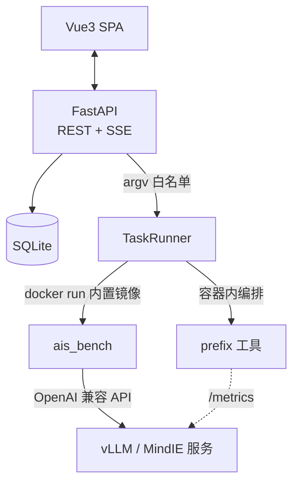

# 🚀 AISBench UI

开箱即用的 [AISBench](https://github.com/AISBench/benchmark) Web 评测控制台：不写命令行完成 LLM 推理服务的性能压测与精度评测，原生集成 prefix cache 专项测试，全链路容器化执行。

> **拿来即用**：aisbench 源码、prefix 工具、gsm8k 数据集、plotly.js、docker 镜像全部随包内置——解压后执行 `bash install.sh` 即可，无需联网拉取任何东西。

## ✨ 特性

| 能力 | 说明 |
|---|---|
| 🖥 可视化压测 | 表单化 ais_bench 全部常用参数；6 种 API 调用模式（stream_chat / general / function_call_chat 等）逐字对齐官方配置 |
| 🧪 合成数据集 | 官方 SyntheticDataset 机制：`string`（随机文本，输入/输出长度精确控制）与 `tokenid`（token id 序列 + 公共前缀长度）双模式，零数据文件依赖 |
| 🧩 Prefix 专项 | 一键串联「前缀数据集生成 → 压测 → vLLM prefix cache 命中率采集」，容器内执行无需本机依赖 |
| ⚖️ 智能对比 | 同配置任务自动归组对比（逐指标小图 + 平均/P50/P99）；支持跨配置总览 |
| 📊 结果呈现 | 指标卡（含分位值）、明细/汇总双表格、aisbench 原生 plotly 图表（本地化渲染） |
| 🩺 环境自检 | 执行方式自动探测，docker 镜像内置离线加载 |
| 🔒 安全边界 | argv 白名单 + 子进程无 shell + 路径白名单 + 访问 Token |

## 🚀 一键安装（离线）

```bash
bash install.sh
```

脚本自动完成：加载内置 docker 镜像 → 安装后端依赖 → 就绪检查 → 启动服务 → 打印访问地址与 Token。
仅后端依赖安装（约 15MB）需要网络，其余全部离线。

管理子命令：

```bash
bash install.sh image   # 仅加载内置镜像
bash install.sh deps    # 仅安装后端依赖
bash install.sh start   # 启动服务
bash install.sh stop    # 停止服务
bash install.sh token   # 打印访问 Token
```

## 🖼 界面预览

> 截图占位：概览仪表盘 / 新建任务表单 / 任务详情（指标卡+日志）/ Prefix 专项 / 结果对比

## 🧭 架构



## ⚙️ 配置（全部可选）

| 变量 | 默认 | 说明 |
|---|---|---|
| `AISBENCH_WORK_PATH` | 仓库内 `aisbench/benchmark` | aisbench 源码目录 |
| `PREFIX_TOOL_DIR` | 仓库内 `aisbench/aisbench_auto_tools_prefix` | prefix 工具目录 |
| `AISBENCH_LAUNCH_MODE` | `auto` | auto（优先 docker）/ cli / source / docker |
| `AISBENCH_UI_DATASET_DIRS` | 空 | 额外数据集目录（路径白名单） |
| `AISBENCH_UI_MAX_PARALLEL` | `2` | 全局并行任务数（同一服务始终串行） |
| `AISBENCH_UI_PORT` | `8001` | 服务端口 |

## 📖 功能速览

- **新建任务**：模型参数取自「服务管理」；数据集三选一（内置缩写 / 合成 string+tokenid / 自定义 jsonl）；逐任务覆盖并发与输出长度；API 调用模式六选一
- **Prefix 专项**：数据集生成（长度分布高斯/均匀）→ 前缀配置 → 压测执行 → 命中率采集（vLLM metrics 节点可视化编辑）四区表单
- **任务详情**：阶段进度条 + SSE 实时日志 + 指标卡（avg/p50/p99）+ 双表格 + 原生 plotly 图表 + 产物浏览
- **结果对比**：同配置自动归组逐指标直比；跨配置总览；导出 CSV
- **服务管理 / 自检 / 一键修复**：探活、依赖与镜像状态一目了然

## 🔒 安全设计

argv 白名单（硬编码参数名 + 类型/范围校验）｜子进程无 shell｜路径 realpath 白名单｜prefix 工具 config.py repr 注入 + 用后还原｜访问 Token（`data/token.txt`）｜非 root 容器执行

## 🧱 目录结构

```
├── install.sh                        # 唯一脚本：安装/镜像/启停管理
├── docker/aisbench-image-*.tar.gz    # 内置 docker 镜像（离线）
├── aisbench/benchmark                # 内置 aisbench 源码 (MIT)
├── aisbench/aisbench_auto_tools_prefix  # 内置 prefix 专项工具 (MIT)
├── datasets/gsm8k/                   # 内置数据集（首启自动安装）
├── backend/                          # FastAPI（含内置 plotly.js）
├── frontend/                         # Vue3 源码与构建产物 dist/
└── docker-compose.yml / .env.example / THIRD_PARTY_NOTICES.md
```

## ❓ FAQ

- **页面要 Token？** `install.sh` 结束时打印，或 `cat data/token.txt`；换浏览器需重填
- **容器里连不上宿主机服务？** 服务地址填 `http://host.docker.internal:8000`（已配 host-gateway）
- **图表空白？** plotly.js 已内置本地渲染；仍空白请看浏览器 Console
- **TTFT 为空？** 非 stream_chat 模式无首 token 时间，属原理性缺失
- **命中率 CSV 缺失？** 需在「命中率采集」填写 vLLM metrics 节点且服务暴露 `/metrics`
- **新机器提示拉镜像？** docker 镜像就是 aisbench 的依赖本体（约 1-2GB，一次性）。三种获取方式：① 自检页该条目旁「一键修复」后台拉取；② `docker pull ghcr.io/aisbench/aisbench_benchmark:v3.1-20260415-master_aarch64_py_310`；③ 在有网的同架构机器上 `docker save <镜像> | gzip > aisbench-image.tar.gz`，目标机执行 `bash install.sh image` 离线导入

## 🤝 贡献

欢迎 Issue 与 PR，规范见 [CONTRIBUTING.md](CONTRIBUTING.md)。改动涉及评测参数时，请同步维护 `runner.py` 白名单与 `formSchema.js`。

## 📄 许可证

[MIT](LICENSE) © 2026 aisbench-ui contributors。第三方组件见 [THIRD_PARTY_NOTICES.md](THIRD_PARTY_NOTICES.md)；内置的 aisbench 与 prefix 工具遵循其原始 MIT 许可证。
